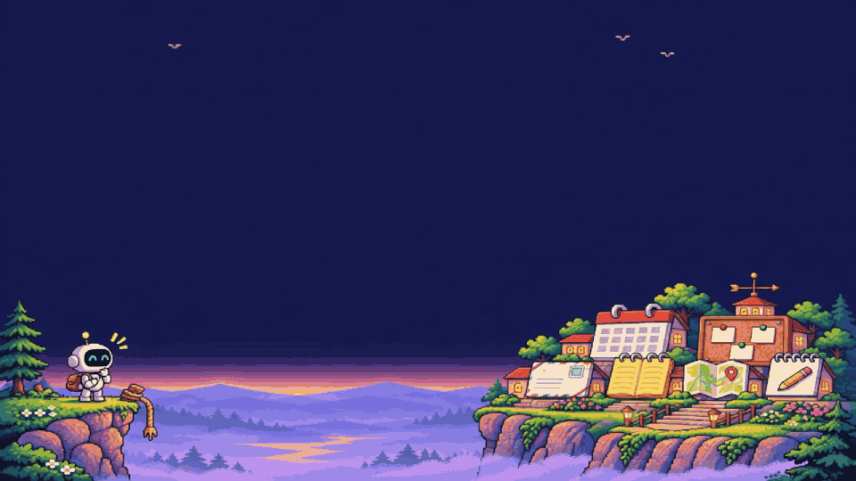

# Gesher

<p align="center">
  <picture>
    <source media="(prefers-color-scheme: dark)" srcset="docs/assets/banner-dark.png">
    <source media="(prefers-color-scheme: light)" srcset="docs/assets/banner-light.png">
    
  </picture>
</p>

<p align="center"><b>Let Claude, Codex, Cursor or any MCP client work with seven Apple apps, including Reminders sections, Notes tags and Freeform boards.</b></p>

<p align="center">
  <a href="https://github.com/EphraimElgrabli/gesher/releases/latest"></a>
  
  
  <a href="LICENSE"></a>
</p>

<p align="center"></p>

## Install

Gesher is experimental and maintained. Connect only the apps you need, and review what your agent changes.

Requires an Apple silicon Mac running macOS 26 or later. Tested on macOS 27; macOS 26 should work but hasn't been tested yet. The binaries are not notarized: the installer signs them locally and may ask for your password to create a signing certificate. `GESHER_SIGN_IDENTITY=-` skips the certificate, but then you grant access again after each update.

```sh
curl -fsSL https://raw.githubusercontent.com/EphraimElgrabli/gesher/main/install.sh | bash
```

The installer finds your AI apps and asks which ones to connect. Then, in a new Terminal window, run `gesher permissions` and click **Allow**. Notes and Freeform also need one drag into Full Disk Access, and Gesher opens that window for you. Restart your AI app. To connect more apps later, run `gesher connect`. [Permissions](docs/permissions.md) · [Other AI apps](docs/clients.md)

Prefer to let your agent do it? Paste this into Claude Code, Codex or Cursor:

```text
Install Gesher on my Mac by following https://raw.githubusercontent.com/EphraimElgrabli/gesher/main/docs/install.md
```

## Try it

> *"Turn my Lisbon trip note into a packing list in Reminders, due the day before the flight."*

Your agent reads the note and creates the reminders. With iCloud, they show up on your iPhone too.

## Why Gesher

I built Gesher for my own work. I wanted to stay in Apple's apps instead of adding more apps and subscriptions, and to finally have the assistant I wanted Siri to be. The technical challenge interested me too.

- **Features the public APIs don't have.** Gesher calls the frameworks Apple's apps are built on, including private frameworks Apple doesn't document for third-party use (a macOS update may break them). 62 of its 117 tools do something no public Apple framework offers, like Reminders sections and smart lists, Notes tags and tables, and Freeform boards. [Tool-by-tool comparison](docs/public-apis.md) · [How it works](docs/architecture.md)
- **The apps can stay closed.** No AppleScript, no Shortcuts, no clicking through windows. Freeform opens quietly in the background when an agent adds to a board.
- **It checks its work.** Every write is read back. Bulk deletes are backed up first, deleted reminders and notes go to Recently Deleted, and Notes edits can be tied to the version the agent read.

## What your agent can do

| | App | Your agent can… | Tools |
|:-:|---|---|:-:|
| <picture><source media="(prefers-color-scheme: dark)" srcset="docs/assets/apps/reminders-dark.png"></picture> | **Reminders** | add, complete and organize tasks: lists, sections, tags, subtasks, smart lists | [28](apps/reminders/README.md) |
| <picture><source media="(prefers-color-scheme: dark)" srcset="docs/assets/apps/calendar-dark.png"></picture> | **Calendar** | read your agenda, find free time, create and move events, answer invitations | [17](apps/calendar/README.md) |
| <picture><source media="(prefers-color-scheme: dark)" srcset="docs/assets/apps/contacts-dark.png"></picture> | **Contacts** | find people by name, phone or email, and update cards | [21](apps/contacts/README.md) |
| <picture><source media="(prefers-color-scheme: dark)" srcset="docs/assets/apps/notes-dark.png"></picture> | **Notes** | read and write notes as Markdown, with checklists, tables and tags | [29](apps/notes/README.md) |
| <picture><source media="(prefers-color-scheme: dark)" srcset="docs/assets/apps/maps-dark.png"></picture> | **Maps** | search places, see opening hours, plan routes and travel times (read-only) | [6](apps/maps/README.md) |
| <picture><source media="(prefers-color-scheme: dark)" srcset="docs/assets/apps/weather-dark.png"></picture> | **Weather** | check the forecast hour by hour, air quality and severe-weather alerts; minute-by-minute rain in some countries | [10](apps/weather/README.md) |
| <picture><source media="(prefers-color-scheme: dark)" srcset="docs/assets/apps/freeform-dark.png"></picture> | **Freeform** | search every board, create boards, add text, links, images and files | [6](apps/freeform/README.md) |

Every app is also a command-line tool, for example `calendar-cli agenda tomorrow`. Each app's README lists its commands.

## Good to know

- **Privacy:** Gesher itself runs on your Mac, with no Gesher servers, accounts or telemetry. Maps and Weather use Apple's services; whatever you share with an agent goes to its provider.
- **Stability:** the frameworks Gesher uses aren't a stable API, so a macOS update can break parts of it. Gesher then stops with a clear error, and `gesher doctor` shows what's affected. [Limitations](docs/limitations.md)
- **Trust:** each release is built from its tagged commit and published with a `.sha256` file, which the installer checks. [Security](SECURITY.md)
- **Questions:** [FAQ](docs/faq.md), including how Gesher differs from AppleScript-based MCP servers.
- **Other languages:** [עברית](docs/i18n/README.he.md) · [简体中文](docs/i18n/README.zh-CN.md) · [日本語](docs/i18n/README.ja.md) · [more](docs/i18n/)

---

I'm Ephraim Elgrabli. I built Gesher for my own work and share it under [GPL-3.0](LICENSE). Gesher (גשר) is Hebrew for *bridge*. Bug reports are welcome, especially after macOS updates ([open an issue](https://github.com/EphraimElgrabli/gesher/issues/new/choose)); pull requests are welcome but reviewed slowly ([CONTRIBUTING](CONTRIBUTING.md)); questions go in [Discussions](https://github.com/EphraimElgrabli/gesher/discussions); security reports go through [private reporting](SECURITY.md). Not affiliated with Apple Inc. · [Legal notes](docs/legal.md)
