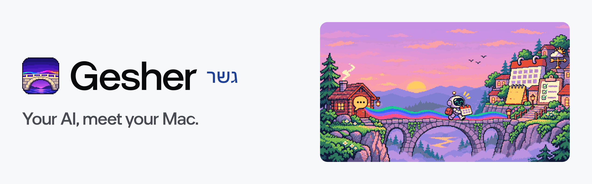

<p align="center">
  <picture>
    <source media="(prefers-color-scheme: dark)" srcset="../assets/banner-dark.png">
    <source media="(prefers-color-scheme: light)" srcset="../assets/banner-light.png">
    
  </picture>
</p>

<h3 align="center" dir="rtl">ה-AI שלכם, תכירו את ה-Mac שלכם.</h3>

<p align="center" dir="rtl">
  Gesher נותן ל-Claude, ל-Codex, ל-Cursor ולכל אפליקציית AI אחרת שתומכת ב-MCP לעבוד עם<br>
  <b>Reminders, Calendar, Contacts, Notes, Maps, Weather</b> ו-<b>Freeform</b>,<br>
  באופן טבעי ופרטי, ממש על ה-Mac שלכם. בלי AppleScript, בלי Shortcuts, בלי קליקים על המסך.
</p>

<p align="center">
  <a href="https://github.com/EphraimElgrabli/gesher/releases/latest"></a>
  
  
  <a href="../../LICENSE"></a>
</p>

<p align="center">
  <sub>
  <a href="../../README.md">English</a> ·
  <b>עברית</b> ·
  <a href="README.zh-CN.md">简体中文</a> ·
  <a href="README.ja.md">日本語</a> ·
  <a href="README.ko.md">한국어</a> ·
  <a href="README.es.md">Español</a> ·
  <a href="README.fr.md">Français</a> ·
  <a href="README.de.md">Deutsch</a> ·
  <a href="README.pt-BR.md">Português</a> ·
  <a href="README.ru.md">Русский</a>
  </sub>
</p>

<div dir="rtl">

*ייתכן שהתרגום הזה מפגר אחרי [ה-README באנגלית](../../README.md), שהוא הגרסה המחייבת.*

<p align="center">
  🔒 <b>Gesher עצמו רץ כולו על ה-Mac שלכם.</b> בלי שרתים של Gesher, בלי חשבונות, בלי טלמטריה.
</p>

> [!TIP]
> **סוכני AI:** קראו את [`llms.txt`](../../llms.txt) למפת הפרויקט, ואת
> [`docs/install.md`](../install.md) כדי להתקין את Gesher עבור המשתמש שלכם.

## מתחילים בדקה

**הדרך הקלה: מבקשים מהסוכן.** הדביקו את זה ב-Claude Code, ב-Codex, ב-Cursor או בכל סוכן שיודע להריץ
פקודות:

```text
התקן את Gesher על ה-Mac שלי וחבר אותו לאפליקציות ה-AI שלי לפי ההוראות בכתובת
https://raw.githubusercontent.com/EphraimElgrabli/gesher/main/docs/install.md
```

**או לבד, בשלושה צעדים:**

**1. מתקינים.** שורה אחת ב-Terminal. המתקין מוצא את אפליקציות ה-AI שלכם ושואל אילו לחבר.

```sh
curl -fsSL https://raw.githubusercontent.com/EphraimElgrabli/gesher/main/install.sh | bash
```

**2. אומרים כן ל-macOS.** בחלון Terminal חדש מריצים `gesher permissions` ולוחצים **Allow**. ‏Notes
ו-Freeform צריכים גרירה אחת לתוך Full Disk Access; ‏Gesher פותח לכם את החלון.

**3. שואלים.** מפעילים מחדש את אפליקציית ה-AI ומנסים *"מה יש לי ביומן מחר?"*

<p align="center">
  <b>עובד עם</b><br>
  
  
  
  
  
  
  
  
  
  
  
  
  
  
  
</p>

## נסו לשאול

> *"איך נראה השבוע שלי? תמצא שעתיים פנויות לעבודה מרוכזת ותחסום אותן."*

> *"תהפוך את הפתק **טיול לליסבון** לרשימת ציוד ב-Reminders, עם תאריך יעד יום לפני הטיסה."*

> *"יירד גשם בריצה שלי ב-18:00? אם כן, תעביר אותה למחר בבוקר."*

> *"למי יש יום הולדת החודש? תוסיף רעיונות למתנות לפתקים שלי."*

> *"תמצא בית מרקחת שפתוח עכשיו ליד הפגישה הבאה שלי, וכמה זמן ההליכה לשם."*

> *"תכין לוח Freeform לשיפוץ המטבח עם הקישורים מהפתק **מטבח**."*

| בלי Gesher | עם Gesher |
|---|---|
| *"אין לי גישה ליומן שלך, אבל אתה יכול לבדוק ולספר לי…"* | קורא את הלו״ז, מוצא את החלון הפנוי וקובע. ✅ |
| מעתיקים פתק לצ׳אט, ואז מעתיקים את התשובה בחזרה. | הסוכן קורא את הפתק ועורך אותו במקום, כ-Markdown. ✅ |
| מבקשים תזכורת, והסוכן אומר לכם לפתוח את Reminders. | *"תזכיר לי לקנות חלב כשאני יוצא מהמשרד."* בוצע, עם התראת מיקום. ✅ |

## מה הסוכן שלכם יכול לעשות

| | אפליקציה | הסוכן שלכם יכול… | |
|:-:|---|---|:-:|
| <picture><source media="(prefers-color-scheme: dark)" srcset="../assets/apps/reminders-dark.png"></picture> | **Reminders** | להוסיף, לסמן ולסדר משימות: רשימות, מקטעים, תגיות, תתי-משימות, רשימות חכמות, תבניות | [28 כלים](../../apps/reminders/README.md) |
| <picture><source media="(prefers-color-scheme: dark)" srcset="../assets/apps/calendar-dark.png"></picture> | **Calendar** | לקרוא את הלו״ז, למצוא זמן פנוי, ליצור ולהזיז אירועים, להשיב להזמנות | [17 כלים](../../apps/calendar/README.md) |
| <picture><source media="(prefers-color-scheme: dark)" srcset="../assets/apps/contacts-dark.png"></picture> | **Contacts** | למצוא כל אחד לפי שם, טלפון או מייל, לעדכן כרטיסים, קבוצות, ימי הולדת | [21 כלים](../../apps/contacts/README.md) |
| <picture><source media="(prefers-color-scheme: dark)" srcset="../assets/apps/notes-dark.png"></picture> | **Notes** | לקרוא ולכתוב פתקים כ-Markdown, עם רשימות סימון, טבלאות, תגיות וקבצים מצורפים | [29 כלים](../../apps/notes/README.md) |
| <picture><source media="(prefers-color-scheme: dark)" srcset="../assets/apps/maps-dark.png"></picture> | **Maps** | לחפש מקומות, לראות שעות פתיחה, לתכנן מסלולים וזמני נסיעה | [6 כלים](../../apps/maps/README.md) |
| <picture><source media="(prefers-color-scheme: dark)" srcset="../assets/apps/weather-dark.png"></picture> | **Weather** | לבדוק את התחזית בכל מקום, שעה אחר שעה, וגם את איכות האוויר | [10 כלים](../../apps/weather/README.md) |
| <picture><source media="(prefers-color-scheme: dark)" srcset="../assets/apps/freeform-dark.png"></picture> | **Freeform** | לקרוא את הלוחות שלכם, ליצור חדשים, להוסיף טקסט, קישורים, תמונות וקבצים | [6 כלים](../../apps/freeform/README.md) |

אם אתם משתמשים ב-iCloud, כל שינוי מגיע גם ל-iPhone ול-iPad, בדיוק כאילו עשיתם אותו בעצמכם.

## מה מייחד אותו

- **הוא באמת נייטיב.** Gesher קורא לאותם frameworks (פרטיים) של macOS שהאפליקציות עצמן משתמשות בהם. בלי
  AppleScript, בלי Shortcuts, בלי הקלקות בחלונות, והאפליקציות לא צריכות להיות פתוחות (רק Freeform
  נפתח בשקט ברקע כשהסוכן שלכם מוסיף משהו ללוח).
- **הוא פרטי.** אין צורך להירשם לשום דבר, שום דבר לא נאסף, ואין מה להגדיר בענן.
- **הוא זהיר.** כל שינוי נקרא בחזרה כדי לוודא שהצליח. לפני מחיקה גורפת נשמר גיבוי.
  תזכורות ופתקים שנמחקו עוברים ל-Recently Deleted, ועריכת פתק יכולה להיות קשורה לגרסה שהסוכן קרא,
  כך שהוא אף פעם לא דורס שינוי שלא ראה.
- **השליטה אצלכם.** ‏macOS מבקש את רשותכם לכל אפליקציה בנפרד, ואפשר לתת לסוכן את ה-Calendar בלי
  ה-Contacts.
- **הוא מדבר בשפת הסוכנים.** שמות במקום מזהים, תאריכים כמו *"next tuesday 14:00"*, ושגיאות שאומרות מה
  לעשות הלאה, כך שהסוכנים מצליחים בפחות ניסיונות.

## והוא גם CLI

```sh
calendar-cli agenda tomorrow
reminders-cli task create 'Call the bank' --due 'friday 9:00'
notes-cli note get 'Packing list' --content markdown
maps-cli nearby pharmacy --near 'Union Square, San Francisco'
```

JSON קומפקטי לסקריפטים ולסוכנים, `--format pretty` לבני אדם. ‏`<app>-cli --help` מסביר את כל השאר.

## מחברים עוד אפליקציות AI אחר כך

```sh
gesher connect            # finds your AI apps and asks which to connect
gesher connect --list     # what's connected where
```

מעדיפים ידנית, או משתמשים במשהו שלא ברשימה? כל אפליקציה היא שרת MCP סטנדרטי
(`reminders-cli mcp`, `calendar-cli mcp`, …): [הגדרה לכל אפליקציית AI](../clients.md).

## שאלות נפוצות

<details>
<summary><b>המידע שלי נשלח לאנשהו?</b></summary>

לא על ידי Gesher. הוא רץ על ה-Mac שלכם ואין לו שרתים. Weather ו-Maps פונים לשירותים של Apple, בדיוק
כמו שהאפליקציות האלה עושות. מה שאתם משתפים עם סוכן AI מגיע לספק של אותו סוכן, כמו כל דבר אחר שאתם
מקלידים לו; עם מודל מקומי ב-LM Studio או ב-opencode, השיחה לא יוצאת מה-Mac בכלל.
</details>

<details>
<summary><b>זה בטוח לתת לסוכן לשנות לי דברים?</b></summary>

Gesher זהיר (שינויים מאומתים, מחיקות גורפות מגובות ל-`~/.config/gesher/backups`, תזכורות ופתקים
שנמחקו עוברים ל-Recently Deleted), אבל הוא עושה מה שהסוכן מבקש. חברו רק את האפליקציות שאתם צריכים,
ושימו עין על מה שאתם מרשים לסוכן לשנות.
</details>

<details>
<summary><b>מה צריך?</b></summary>

Mac עם Apple silicon ו-macOS 26 ומעלה. Gesher נבדק על macOS 27; על macOS 26 הוא אמור לעבוד, אבל עוד לא
נבדק. מחשבי Mac עם Intel לא נתמכים. לא צריך Xcode.
</details>

<details>
<summary><b>מה הוא לא יודע לעשות?</b></summary>

הערות באנשי קשר וחלק מהעריכות ב-Freeform (צורות, פתקיות, שינוי שם של לוח)
שמורים על ידי macOS לאפליקציות של Apple עצמה. Maps זמין לקריאה בלבד. [הרשימה המלאה](../limitations.md).
</details>

<details>
<summary><b>למה המתקין מבקש את הסיסמה שלי?</b></summary>

רק כדי ליצור תעודת חתימה על ה-Mac שלכם, כך שעדכונים ישמרו על ההרשאות שנתתם. אם תסרבו, Gesher עדיין
עובד; פשוט תצטרכו לאשר גישה מחדש אחרי עדכונים.
</details>

<details>
<summary><b>במה זה שונה משרתי MCP מבוססי AppleScript?</b></summary>

AppleScript רואה רק את מה שכל אפליקציה בחרה לחשוף לסקריפטים, צריך שהאפליקציה תהיה פתוחה, ומבקש הרשאת
Automation. ‏Gesher קורא ישירות ל-frameworks שעליהם האפליקציות בנויות: הוא מהיר יותר, עובד גם כשהאפליקציות
סגורות, ומגיע למה שסקריפטים לא מגיעים אליו, כמו מקטעים ורשימות חכמות ב-Reminders, תגיות וטבלאות ב-Notes,
ולוחות ב-Freeform.
</details>

<details>
<summary><b>אפשר לסמוך על ההורדה?</b></summary>

כל גרסה נבנית מה-commit המתויג במאגר הזה ומתפרסמת עם קובץ `.sha256`. המתקין בודק את ה-SHA-256 של ההורדה. הכלים לא עוברים notarization של Apple; במקום
זה, המתקין חותם עליהם על ה-Mac שלכם. [הערות האבטחה](../../SECURITY.md) מסבירות מפני מה ההרשאות של
Gesher מגינות.
</details>

<details>
<summary><b>עדכון של macOS ישבור אותו?</b></summary>

ייתכן: Gesher משתמש בחלקים של macOS ש-Apple לא מתחייבת לשמור יציבים. אם משהו משתנה, Gesher עוצר עם
הודעה ברורה במקום לנחש, ו-`gesher doctor` מראה מה הושפע.
</details>

<details>
<summary><b>איך מעדכנים או מסירים?</b></summary>

`gesher update` מתקין את הגרסה האחרונה ושומר על ההרשאות והחיבורים שלכם. ‏`gesher uninstall` מסיר את
Gesher ומנתק אותו מאפליקציות ה-AI שלכם.
</details>

<details>
<summary><b>מה זה "Gesher"?</b></summary>

נו, אתם כבר יודעים: זה פשוט *גשר* בעברית (גשר), ומבטאים בדיוק כמו שחשבתם: *GEH-sher*. גשר קטן בין ה-AI שלכם לבין ה-Mac.
</details>

## איך זה עובד

כל אפליקציה ב-Mac מקבלת כלי שורת פקודה קטן שהוא גם שרת [MCP](https://modelcontextprotocol.io).
הוא טוען את ה-framework שעליו האפליקציה עצמה בנויה וקורא לו ישירות, כך שכל שינוי עובר באותה דרך כאילו
עשיתם אותו באפליקציה. הצהרה אחת לכל פעולה הופכת לפקודת ה-CLI, לעזרה שלה, לכלי ה-MCP ול-schema שלו,
כך שהם אף פעם לא מתרחקים זה מזה.

לקריאה נוספת: [ארכיטקטורה](../architecture.md) · [הרשאות](../permissions.md) ·
[הגדרת אפליקציות AI](../clients.md) · [מדריך התקנה לסוכנים](../install.md) · [תרומה ב-fork](../../AGENTS.md)

## על הפרויקט

Gesher ניסיוני ומתוחזק. דיווחי באגים יתקבלו בברכה, במיוחד כשעדכון של macOS שובר משהו: פתחו
[issue](https://github.com/EphraimElgrabli/gesher/issues/new/choose) עם גרסת ה-macOS, האפליקציה והפלט של `gesher doctor`. גם pull requests מתקבלים בברכה, אבל
נבדקים לאט. שאלות ורעיונות ב-[Discussions](https://github.com/EphraimElgrabli/gesher/discussions). דיווחי אבטחה דרך [דיווח פרטי](../../SECURITY.md).

אם Gesher הופך את ה-Mac שלכם לקצת יותר קסום, ⭐ עוזר לאחרים למצוא אותו.

<sub>Gesher הוא פרויקט עצמאי, ללא קשר ל-Apple Inc. וללא אישור ממנה. Apple, ‏Mac, ‏macOS, ‏iCloud ושמות
האפליקציות הם סימנים מסחריים של Apple Inc., ומוזכרים כאן רק כדי לציין עם אילו אפליקציות Gesher עובד.
Gesher לא כולל קוד או גרפיקה של Apple. [הערות משפטיות](../legal.md) ·
[GPL-3.0](../../LICENSE) © Ephraim Elgrabli</sub>

</div>
